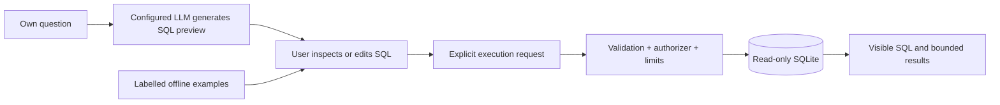

# SQL Analytics Lab

A Python analytics workbench that separates **generating SQL, inspecting it, and executing it**. Ask a configured LLM your own question, review its SQL preview, then explicitly run the query against a read-only fictional sales database. Without provider configuration, six labelled guided examples and the SQL editor work completely offline.

**Current state:** local rebuild, not published or deployed. Older hosted applications and deleted GitHub repositories are not evidence for this version. No claim of outperforming DataSense is made.

## What a recruiter can review

- Python/OOP core, FastAPI REST endpoints, typed request validation and visible SQL/results.
- Optional OpenAI-compatible generation with a configurable model/endpoint, ten-second timeout, no SDK retries, bounded output and two concurrent preview requests.
- Separate preview and execution actions: the model never automatically runs SQL in the browser workflow.
- SQLite read-only URI mode, execution-time authorizer, table allowlist, one-second query deadline, 100-row cap and 1 MiB SQLite value limit.
- Tests for validator bypass, writes, hidden-schema reads, unsafe functions, oversized values, prompt-output refusal, provider failures, disabled-mode isolation and concurrency.
- Original deterministic evaluation fixtures in two domains. Reference SQL correctness and real model-generation accuracy are recorded separately.

## Run locally

Python **3.11+** is required; Python 3.12 is the tested baseline. The environment uses SQLite's connection limit API.

```bash
uv venv --python 3.12 .venv
source .venv/bin/activate
uv pip install -r requirements-web.txt httpx pytest pytest-subtests
uvicorn web:app --host 127.0.0.1 --port 8000
```

Open `http://127.0.0.1:8000` or `/docs`. No credentials are required for offline mode. The synthetic database is created at startup and removed on shutdown. No customer data or database URL can be submitted through the web API.

### Enable actual model previews

Configure secrets in your local shell or deployment secret store, never in Git:

```bash
export SQL_LLM_ENABLED=true
export SQL_LLM_MODEL=your-provider-model
# Set OPENAI_API_KEY securely, outside version control.
# Optional for an OpenAI-compatible service:
export OPENAI_BASE_URL=https://your-provider.example/v1
uvicorn web:app --host 127.0.0.1 --port 8000
```

The server sends the question and schema to the configured provider. Model requests happen only after submitting your own question to `/api/generate`. Guided examples do not call a model even when it is enabled. A preview can still contain incorrect SQL or answer the wrong question; inspecting and executing it does not prove semantic correctness.

This version has no authentication or per-user monetary quota. Keep provider-enabled mode on a trusted local/private deployment; add authentication and budget controls before offering public paid-provider access. Two concurrent requests is a resource bound, not a cost budget. A local OpenAI-compatible server can be used with its required model and key configuration; no such server was exercised here.

## Two-minute demonstration

1. Choose **Revenue by region** and inspect the predefined SQL and actual database rows.
2. Run `SELECT COUNT(*) AS customers FROM customers` in the editor.
3. Try `DELETE FROM customers`: it is refused.
4. In provider-enabled mode, ask your own question and choose **Generate SQL preview**.
5. Inspect/edit the returned SQL, then choose **Run query**. Generation and execution remain separate.

## API

| Endpoint | Behavior |
|---|---|
| `GET /healthz` | Runtime status and whether model previews are enabled |
| `GET /api/schema` | Sales schema, guided examples and configured model name |
| `POST /api/generate` | `{ "question": "..." }` → validated SQL preview; never executes |
| `POST /api/query` | `{ "sql": "..." }` → bounded real rows, query and elapsed time |
| `POST /api/ask` | Guided predefined questions only; does not call a model |

Disabled model generation returns 503, occupied generation slots 429, provider/invalid model output 502, and refused/failed SQL 422. Provider exception details are redacted to the exception class; credentials and provider error text are not sent to browsers.

## Architecture



The SQLite authorizer is installed only during execution so schema introspection can operate normally. It permits SELECT/READ/FUNCTION/recursive operations, rejects writes/attach/PRAGMA operations, limits reads to the displayed web tables, and blocks extension/file/blob functions. The 1 MiB SQLite length limit bounds individual values, not all process memory. Database permissions remain independent of the token parser. The SQL parser is not a formal SQL safety proof.

The library supports other SQLAlchemy dialects and generates a dialect-specific prompt; PostgreSQL/MySQL behavior was not integrated or tested in this rebuild. The additional authorizer and length controls are SQLite-specific.

## Evaluation and verification

```bash
python -m pytest -q
python eval/benchmark.py --mode reference --output /tmp/sales-reference.json
python eval/benchmark.py --mode reference --dataset eval/heldout-support.json --output /tmp/support-reference.json
```

The rebuilt version passed **37 tests plus 15 subtests** on Python 3.12. Reference execution matched **18/18 sales fixtures** and **12/12 support-domain fixtures**. The support schema, questions and answers are separate from browser examples. They are public synthetic fixtures held out from guided examples, not a sealed external evaluation. Saved reports:

- [Sales reference checks](eval/rebuild-reference-report.json)
- [Support reference checks](eval/heldout-reference-report.json)

**Those scores measure executor correctness on handwritten SQL, not LLM accuracy.** Tests mock the provider boundary and therefore prove integration/control flow, not real provider quality. No live model calls or paid resources were used.

For a real generation evaluation, configure a provider and run:

```bash
EVAL_MODEL=your-provider-model python eval/benchmark.py --mode live --dataset eval/heldout-support.json --output /tmp/support-model-results.json
```

The runner sends only the question and schema, not gold SQL or expected rows. Reports record dataset SHA-256, model, executed SQL, rows, failures and per-difficulty results. Alias-independent row comparison preserves duplicate multiplicity and value-column positions; these fixtures do not assess answer ordering. Without a key, live mode records `not_run` and exits 2. No live-model score has been measured.

## Repository map

| Path | Purpose |
|---|---|
| [assistant.py](assistant.py) | SQL library, generation, validation and database guard |
| [web.py](web.py) | Synthetic sales database, explicit provider configuration and API |
| [static](static) | Browser workflow and safe text-based results rendering |
| [eval](eval) | Original datasets, questions, gold rows and evaluation runners |
| [test_generation.py](test_generation.py) | Model preview and database enforcement tests |
| [docs/reference-analysis.md](docs/reference-analysis.md) | Source investigation and design differences |

## Ownership and scope

This is an independently implemented extension of the earlier SQL_Assistant application, developed with AI assistance. [DataSenseQA](https://github.com/raywanb/DataSenseQA), by Felix Krumme, Ray Wan, Dimple Amitha Garuadapuri and Manan Dhanuka, inspired benchmark organization. Its implementation, datasets, questions, scores and awards are not copied or claimed here.

For an interview, explain the code paths and actual modifications you understand; do not describe upstream work or AI-generated work you have not reviewed as independently authored. The code is MIT licensed; see [LICENSE](LICENSE).
