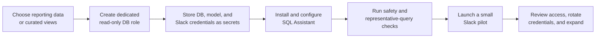

# SQL Assistant

Ask your database questions in plain English. Get trusted, read-only answers back.

SQL Assistant is a small Python service and Slack bot that turns a business
question into SQL, validates that SQL as read-only, and returns a bounded
result. It is intended for analytics and reporting databases—not as a way to
give an LLM unrestricted access to a production database.

```python
from assistant import SQLAssistant

assistant = SQLAssistant("sqlite:///shop.db")
assistant.ask("which customers spent the most last month?")
# {"success": True, "rows": [...], "truncated": False}
```

No SQL required from the person asking. No destructive query ever runs, no matter
what the model is convinced to emit: every statement is parsed and validated
before it touches the database. If a query errors, the error is fed back for
one self-correction attempt.

Live demo (the safety checker, running in your browser):
https://dgexplores.github.io/SQL_Assistant/

## What organizations need to know

Before connecting an organization database, you need:

1. A reporting database, replica, warehouse, or curated views containing only
   data the intended users may access.
2. A dedicated database identity with `SELECT` permissions only—never an
   administrator or application-writer account.
3. An OpenAI-compatible model provider credential, stored in the
   organization's secret manager.
4. For Slack use, a workspace-owned Slack app with Socket Mode and the
   `app_mentions:read` and `chat:write` scopes.
5. Named owners for the database connection, Slack app, credential rotation,
   access reviews, and incident response.

The full step-by-step rollout, including a PostgreSQL role example and
pre-launch checks, is in [ORG_ONBOARDING.md](ORG_ONBOARDING.md).

## Organization onboarding pipeline



| Stage | Organization action | Evidence of completion |
| --- | --- | --- |
| 1. Scope | Choose the approved database, schemas, tables, and user groups. Prefer a reporting replica, warehouse, or curated views. | Data owner approves the data boundary. |
| 2. Permissions | Create a dedicated database account with `SELECT` only. Do not use an administrator or application-writer account. | The account cannot create, update, delete, or alter data. |
| 3. Secrets | Store `DB_URL`, model-provider key, and—if used—Slack tokens in the organization's secret manager. | No credentials are committed to Git or shared in chat. |
| 4. Configure | Install the package, inject environment variables, and configure the model and database connection. | The service starts using the dedicated read-only identity. |
| 5. Verify | Run tests and ask representative questions against non-production data. Test rejected write statements too. | `python3 -m pytest -v` passes and the database denies writes. |
| 6. Pilot | Install the Slack app for a small approved group and collect feedback. | Pilot users can query only approved data. |
| 7. Operate | Review access, monitor usage, and rotate credentials under normal security policy. | Named owners and an access-review cadence exist. |

For the exact commands and a PostgreSQL role example, continue with
[ORG_ONBOARDING.md](ORG_ONBOARDING.md).

## Three ways to use it

**1. Python library.** Point it at any SQLAlchemy database and call `ask()`.
Works with OpenAI, any OpenAI-compatible provider (`base_url`), or local
Ollama with a dummy key. See [Setup](#setup) and
[Configuration](#configuration).

**2. Slack bot.** Mention `@dbbot` with a question, get rows back as a table.
Runs in Socket Mode from any machine, no public URL. See
[Slack bot](#slack-bot).

**3. Landing page demo.** `docs/` holds a static page with a working
in-browser port of the validator. See [Landing page](#landing-page).

For a production or team rollout, follow the
[organization onboarding checklist](ORG_ONBOARDING.md) before connecting a
database.

## Why the safety layer is real

Every failure mode was measured against `sqlparse`, not assumed:

| Input | Result |
| --- | --- |
| `DROP` / `DELETE` / `CREATE` | rejected |
| `''`, `'   '` (empty query) | rejected |
| `SELECT 1; DROP TABLE users` (multi-statement) | rejected |
| `EXPLAIN SELECT 1` | rejected |
| `WITH x AS (DELETE FROM users RETURNING *) SELECT * FROM x` | rejected |
| `WITH x AS (SELECT 1) SELECT * FROM x` (read-only CTE) | allowed |

The data-modifying CTE row is the one that matters. `sqlparse` types that
statement as `SELECT`, so a top-level type check alone accepts a query that
deletes every row. Token-level keyword inspection is what actually stops it.
22 tests / 15 subtests cover these boundaries, runnable with no API key.

**The tradeoff, stated plainly:** telling an LLM "only return SELECT
statements" is a prompt, and prompts are not a security boundary. Parsing the
SQL is deterministic: the same string always gets the same verdict. The cost
is that `sqlparse` is not a full SQL parser, so the denylist is conservative
and does **not** replace a read-only database role. Both guards are needed.
Full reasoning: [SECURITY_TRADEOFFS.md](SECURITY_TRADEOFFS.md).

## How it works

| Layer | Responsibility |
| --- | --- |
| `get_schema()` | Inspect live tables, column types, and foreign keys for the prompt |
| `validate_sql()` | Reject empty, multi-statement, non-SELECT, write-keyword queries |
| `execute_query()` | Bound input size, execute, cap rows, return one failure shape |
| `_generate_and_run()` | Single LLM call path; converts LLM failures to `{"error": ...}` |

Every public method returns a dict, never raises for expected failures:

```python
{"success": True, "rows": [...], "truncated": False}
{"error": "Unsupported statement type: DROP"}
```

## Configuration

`SQLAssistant(db_url, max_rows=1000, timeout_s=30, max_sql_chars=20000, model="gpt-4o-mini", llm_timeout_s=30, base_url=None)`

- `max_rows` — result cap. Results report `truncated: true` when more rows exist.
- `max_sql_chars` — rejects oversized SQL *and* oversized questions before any DB or LLM call.
- `timeout_s` — SQLite busy timeout; Postgres `statement_timeout` via libpq `options` (psycopg2/psycopg). MySQL has no connect-level equivalent.
- `model`, `llm_timeout_s`, `base_url` — which model answers, how long it may take, and where to reach it (OpenAI default; any OpenAI-compatible endpoint works).

## Setup

### Use as a Python library

```bash
python3 -m venv .venv
source .venv/bin/activate
pip install .
export OPENAI_API_KEY=sk-...
python3 -m pytest -v
```

Tests run without an API key — the LLM client is created lazily and only on an
actual LLM call. Local Ollama works with any dummy key plus
`base_url="http://localhost:11434/v1"`.

`.env.example` is a configuration reference. This project does not load `.env`
automatically; inject its values as environment variables through your shell,
deployment platform, or secret manager.

### Organization rollout

Use this sequence for a safe first deployment:

1. Follow [ORG_ONBOARDING.md](ORG_ONBOARDING.md) to define the data boundary
   and create the read-only database identity.
2. Install the package with `pip install '.[slack]'` if your users will access
   it from Slack.
3. Configure the secrets and `DB_URL` in your approved secret manager.
4. Run the test suite and the pre-launch verification checks in the onboarding
   guide against a non-production dataset.
5. Deploy the Slack bot, invite a small pilot group, and review access before
   broader rollout.

## Slack bot

`slack_bot.py` answers data questions when mentioned (`@dbbot unpaid orders
from Berlin?`) using Socket Mode, so it runs from any machine with no public
URL. All questions go through `ask()`, so the safety guards apply unchanged.

```bash
# installs the library plus Slack integration
pip install '.[slack]'
export SLACK_BOT_TOKEN=xoxb-... SLACK_APP_TOKEN=xoxa-... DB_URL=sqlite:///shop.db
python3 slack_bot.py
```

Create the app at api.slack.com/apps: enable Socket Mode, subscribe to
`app_mention`, add scopes `app_mentions:read` and `chat:write`, install it.
Model selection is env-driven (`LLM_MODEL`, `OPENAI_BASE_URL`,
`OPENAI_API_KEY`).

## Accuracy eval

`eval/` holds a five-question gold set over a seeded customers/orders database
plus `run_eval.py`, which asks each question end-to-end and compares rows with
an order-insensitive normalization (tolerates column order and aggregate
labels). It needs a live model and is intentionally outside CI:

```bash
export OPENAI_API_KEY=sk-...
python eval/run_eval.py
```

Latest runs:

| Model | Endpoint | Score | Notes |
| --- | --- | --- | --- |
| `gemini-3.8-flash` | Gemini | 3/5 | Both misses were API-side (503 capacity, 429 quota), not wrong SQL |
| `qwen3:14b` | local Ollama | 4/5 | Fully reproducible, no quota or cost |

The one Ollama miss is a harness strictness limit, not a wrong answer: for
"which customer has the highest order total?" it returned `Ben` with the total
attached, while the gold row holds only the name. Comparison is exact on value
sets, so the extra column fails. The SQL was correct.

## Landing page

`docs/index.html` is a static landing page: self-hosted Geist fonts, Tailwind
v4 compiled to `docs/assets/tailwind.css`, no JS framework, and the validator
demo. Photos are self-hosted CC-licensed images with creator credits. Deployed
via the `pages` workflow; serve locally with
`python3 -m http.server --directory docs`. After adding new Tailwind classes,
recompile from the repo root (requires `tailwindcss` and `@tailwindcss/cli`):

```bash
npx tailwindcss -i docs/tailwind.input.css -o docs/assets/tailwind.css --minify
```

## Status: what's done, what's left

**Done.** Core library with validation and self-correction; resource bounds;
Postgres timeouts; provider-agnostic LLM calls; 22 passing tests with CI on
every push; Slack bot scaffold with tested formatter; live landing page;
accuracy harness with a reproducible local 4/5 run and a hosted 3/5; MIT license.

**Left.**
1. A live Slack deployment against a real workspace (code is written and
   tested; it needs workspace owner tokens to run).
2. MySQL statement timeouts (no connect-level mechanism exists; documented as
   uncovered, mitigated by read-only roles and row caps).
